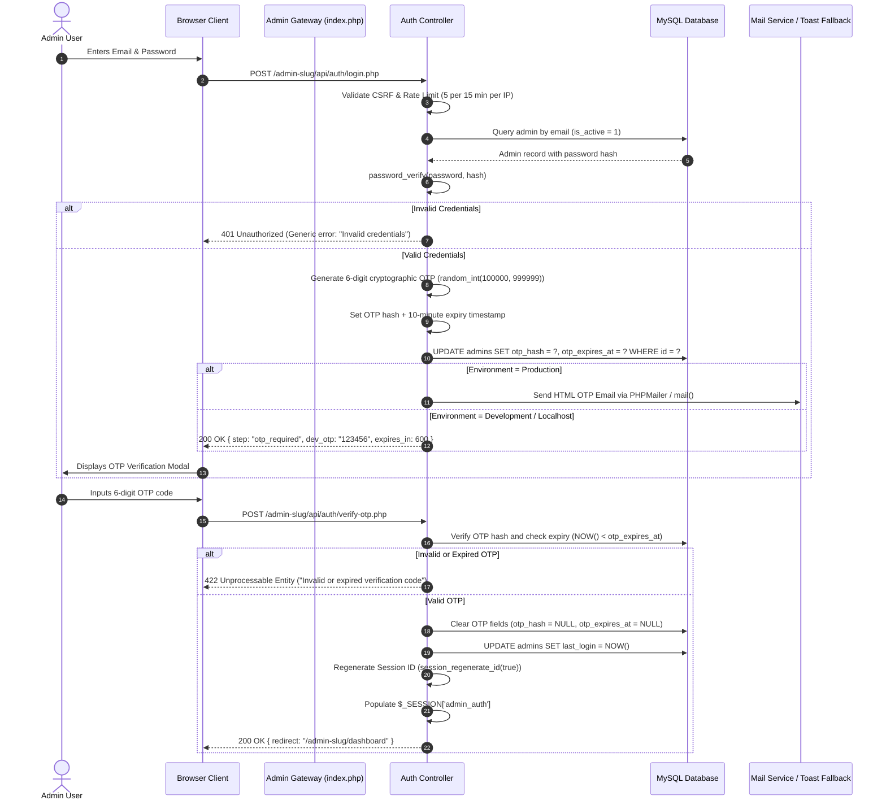

# 02. Admin Authentication, Security, OTP & Password Recovery

## 1. Executive Summary & Purpose
This document establishes the security, authentication, and session management specification for the DreamIT Administrative Console. The console must satisfy enterprise-grade security standards while operating seamlessly across local development (XAMPP) and live production (cPanel/CloudLinux/Apache/Nginx) environments without requiring code modifications.

---

## 2. Authentication Flow Architecture



---

## 3. Database Schema Impact & Alterations

To support secure Two-Factor OTP and Password Recovery without breaking existing admin tables, the following schema migrations are executed:

```sql
-- Migration: Add OTP and Password Reset capabilities to `admins` table
ALTER TABLE `admins`
  ADD COLUMN `status` ENUM('active', 'suspended', 'pending') NOT NULL DEFAULT 'active' AFTER `role`,
  ADD COLUMN `otp_hash` VARCHAR(255) NULL AFTER `two_factor_secret`,
  ADD COLUMN `otp_expires_at` DATETIME NULL AFTER `otp_hash`,
  ADD COLUMN `otp_attempts` TINYINT(2) UNSIGNED NOT NULL DEFAULT 0 AFTER `otp_expires_at`,
  ADD COLUMN `password_reset_token` VARCHAR(128) NULL AFTER `otp_attempts`,
  ADD COLUMN `password_reset_expires_at` DATETIME NULL AFTER `password_reset_token`,
  ADD COLUMN `failed_login_attempts` TINYINT(2) UNSIGNED NOT NULL DEFAULT 0 AFTER `password_reset_expires_at`,
  ADD COLUMN `lockout_until` DATETIME NULL AFTER `failed_login_attempts`;

-- Index for high-speed token lookups
CREATE INDEX `idx_admin_reset_token` ON `admins` (`password_reset_token`);
CREATE INDEX `idx_admin_otp_lookup` ON `admins` (`email`, `otp_expires_at`);
```

---

## 4. Multi-Layer Security Controls

### 4.1. CSRF Protection
- Every HTML form rendered in the admin panel includes a hidden token: `<input type="hidden" name="csrf_token" value="<?= csrf_token() ?>">`.
- Every asynchronous `fetch` or `XMLHttpRequest` request must attach the token either in headers:
  ```javascript
  headers: {
    'X-CSRF-Token': document.querySelector('meta[name="csrf-token"]').getAttribute('content'),
    'Content-Type': 'application/json'
  }
  ```
- If the token is missing or mismatched, the request is immediately rejected with HTTP `403 Forbidden` and logged.

### 4.2. Rate Limiting & Brute Force Prevention
1. **IP-Level Throttling**:
   - Maximum 5 failed attempts per 15-minute sliding window.
   - Stored in session cache or a lightweight file/transient DB table `admin_rate_limits`.
2. **Account-Level Lockout**:
   - After 5 consecutive invalid login attempts for an account, `lockout_until` is set to `NOW() + INTERVAL 20 MINUTE`.
   - The UI does not expose whether the account exists or is locked to prevent account enumeration.

### 4.3. Session Hardening
- Session Cookie Parameters:
  - `cookie_httponly`: `true` (prevents JavaScript access to session cookie).
  - `cookie_samesite`: `'Lax'` or `'Strict'`.
  - `cookie_secure`: `true` automatically if HTTPS is active (detected via `$_SERVER['HTTPS']` or `HTTP_X_FORWARDED_PROTO`).
- On privilege escalation or successful login, `session_regenerate_id(true)` is strictly called.
- Idle Timeout: Sessions automatically expire after 120 minutes of inactivity.

---

## 5. Password Reset Workflow

1. **Step 1: Request Reset Link**:
   - Admin enters registered email address at `/admin-slug/forgot-password`.
   - Controller checks if email exists and account is active.
   - Generates a cryptographically secure 64-character token: `bin2hex(random_bytes(32))`.
   - Saves token hash `hash('sha256', $raw_token)` and 1-hour expiration timestamp in database.
   - Sends email with link: `https://domain.com/{admin_slug}/reset-password?token={raw_token}`.
   - If in local development, returns the reset link in debug output for immediate testing.

2. **Step 2: Reset Password**:
   - Admin lands on reset page; token is validated against `hash('sha256', $_GET['token'])` and `NOW() < password_reset_expires_at`.
   - Password strength validator requires: minimum 8 characters, at least 1 uppercase letter, 1 lowercase letter, 1 number, and 1 special symbol.
   - On submission, new password is hashed using `password_hash($new_password, PASSWORD_BCRYPT, ['cost' => 12])`.
   - Token is invalidated (`password_reset_token = NULL`), all existing session tokens cleared, and admin is redirected to login.

---

## 6. Auto-Environment Adaptation (Production Ready)

| Dimension | Local Development (XAMPP) | Production (cPanel / Live Server) |
| :--- | :--- | :--- |
| **Detection** | `in_array($_SERVER['REMOTE_ADDR'], ['127.0.0.1', '::1'])` | Hostname is production domain |
| **OTP Delivery** | Displays directly in test modal / Toast banner for instant dev testing | Dispatches authentic HTML email via SMTP / sendmail |
| **Error Details** | Detailed JSON error messages & stack traces | Safe sanitized generic errors ("An error occurred. Check audit logs.") |
| **Cookie HTTPS** | Disabled if running on plain `http://localhost` | Enforced `Secure = true` with HSTS header |
| **Password Reset** | Instant copyable link displayed in notification | Secure email dispatch only |
