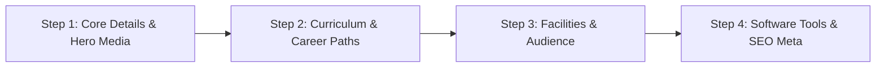

# 03. Admin UI/UX Design System: Modern Grid & Card Architecture

## 1. Design Philosophy: Eliminating Antiquated Tables
Traditional enterprise admin panels rely heavily on dense, uninspired HTML `<table>` elements that fail catastrophically on mobile devices, require horizontal scrolling, and degrade user engagement.

The DreamIT Admin Console implements an **Interactive Grid & Card/Box Architecture**:
- Every entity (Course, Student Project, Department, FAQ, Enquiry) is visualized as a structured **Interactive Card Capsule**.
- Cards leverage CSS Grid (`minmax(320px, 1fr)`) with glassmorphic depth, status badges, contextual action toolbars, and instant inline toggles.
- Information hierarchy is prioritized with visual typography, quick-stat chips, thumbnail previews, and micro-interactions.

---

## 2. Global Layout & Component Blueprint

```
+-----------------------------------------------------------------------------------+
|  DreamIT Console [Logo]  | [Search Global...] | [Quick Add +] | [Profile / Avatar]|
+-----------------------------------------------------------------------------------+
| SIDEBAR NAV        | MAIN CONTENT CANVAS                                          |
|                    |                                                              |
| [Dashboard]        | [Page Header] [Breadcrumb] [Primary Action: + Add New]       |
| [Courses] (Wizard) | ------------------------------------------------------------ |
| [Projects]         | [Metric Box 1]   [Metric Box 2]   [Metric Box 3]             |
| [Departments]      | (Active: 18)     (Pending: 4)     (Inquiries: 42)            |
| [Enquiries]        | ------------------------------------------------------------ |
| [Site Settings]    | [Search & Filter Bar: (Category v) (Status v) (Sort v)]      |
| [SEO Engine]       | ------------------------------------------------------------ |
| [Audit Logs]       | CARD GRID CONTAINER                                          |
|                    | +----------------------+  +----------------------+           |
|                    | | [Thumbnail Image]    |  | [Thumbnail Image]    |           |
|                    | | [Category Pill] [St] |  | [Category Pill] [St] |           |
|                    | | Title of Item        |  | Title of Item        |           |
|                    | | Stats: 120 Enrolled  |  | Stats: 85 Enrolled   |           |
|                    | | [Edit] [Hide] [Del]  |  | [Edit] [Hide] [Del]  |           |
|                    | +----------------------+  +----------------------+           |
+--------------------+--------------------------------------------------------------+
```

---

## 3. Card & Box Architecture Specifications

### 3.1. Entity Card Standard Component
Every card must be composed of the following strict semantic slots:
1. **Card Header / Cover**:
   - High-resolution 16:9 aspect ratio media container with lazy-loading and fallback gradient.
   - Top-right overlay: Status Badge (`Active: Emerald`, `Draft: Amber`, `Archived: Slate`).
   - Top-left overlay: Category / Department tag pill.
2. **Card Body**:
   - **Primary Title**: 2-line clamp (`font-weight: 600`, high contrast).
   - **Meta Chips Container**: Compact pills displaying key operational indicators (e.g., `Duration: 4 Months`, `Lectures: 32`, `Enquiries: 14`).
   - **Financial / Pricing Row**: Regular price (strikethrough) vs discounted live price with discount percentage badge.
3. **Card Quick Actions Footer**:
   - **Quick Status Switcher**: Direct AJAX toggle (Switch active/inactive without navigating away).
   - **Action Button Group**:
     - `Edit` (Primary button: launches editor or multi-step wizard).
     - `Preview` (Opens the corresponding frontend live URL in a new tab).
     - `More (...)`: Dropdown menu with clone, view analytics, and delete with double-confirmation dialog.

### 3.2. Responsive Grid Breakpoints
```css
.admin-card-grid {
  display: grid;
  grid-template-columns: repeat(auto-fill, minmax(320px, 1fr));
  gap: 1.5rem;
  margin-top: 1.5rem;
}

@media (max-width: 768px) {
  .admin-card-grid {
    grid-template-columns: 1fr;
    gap: 1rem;
  }
}
```

---

## 4. Multi-Step Progressive Form Wizard

Complex forms (such as adding or modifying an intensive Course with syllabus, facilities, FAQs, and SEO tags) overwhelm users when displayed as a massive single page. The console implements a **4-Step Guided Wizard**:



### 4.1. Wizard Step Breakdown

#### Step 1: Core Details & Media
- **Fields**: Course Name, URL Slug (auto-generated from name via JavaScript slugifier with manual override), Department Select, Short Summary, Course Level (`Beginner`, `Intermediate`, `Advanced`), Course Duration, Total Lectures, Regular Fee, Discounted Fee.
- **Hero Media**: Banner Image uploader with live thumbnail preview and alternative image URL input.
- **Validation**: Name, Department, and Fee must pass before Step 2 button unlocks.

#### Step 2: Curriculum & Highlights
- **Fields**: Course Overview (Rich Markdown / HTML editor), Key Highlights repeater (dynamic add/remove pill list), Dynamic Curriculum Modules repeater:
  - Module Title, Lecture Count, List of topics covered.
- **Validation**: At least 1 curriculum module must be defined.

#### Step 3: Facilities, Class Structure & Audience
- **Fields**:
  - Class Delivery Mode checkboxes (`Offline in Lab`, `Online Live Zoom`, `Hybrid`).
  - Class Schedule / Structure details (Days per week, hours per class).
  - Target Audience repeater tags (e.g. `Graduates`, `Career Switchers`, `Designers`).
  - Prerequisites text or list.
  - Institutional Facilities included (e.g. `High-spec Core i7 Lab`, `Free Lifetime Support`, `Job Placement Support`).

#### Step 4: Software Tools & SEO Engine
- **Fields**:
  - Software Tools Master Selector (e.g. `Figma`, `Adobe Photoshop`, `Illustrator`, `After Effects` with icon preview pills).
  - SEO Meta Title (Live character count counter: 60 char limit indicator).
  - SEO Meta Description (160 char limit indicator with Google SERP preview box).
  - Focus Keywords input with tag pill chip generator.
- **Actions**:
  - `Save as Draft` (Saves progress without publishing to user frontend).
  - `Publish Live` (Validates full payload, stores in database, updates search cache).

---

## 5. UI Micro-Interactions & Feedback Loops

1. **Optimistic UI Updates**:
   - When an admin toggles a course or project status from "Draft" to "Active", the badge immediately switches color, and a non-blocking toast notification appears: `"Course published successfully"`. If the backend API fails, the switch gracefully reverts with an error alert.
2. **Double-Confirmation Modal for Destructive Actions**:
   - Deleting a course, department, or student project never uses the primitive browser `confirm()`. It triggers an animated modal detailing the consequences (e.g., `"Deleting Graphic Design will also unassign 4 projects and 12 FAQs. Type 'CONFIRM' to proceed"`).
3. **Floating Contextual Save Bar**:
   - In lengthy setting pages, as soon as an input value changes from its baseline, a sticky bottom-docked save bar slides up with: `"You have unsaved changes [Discard] [Save Changes]"`.
