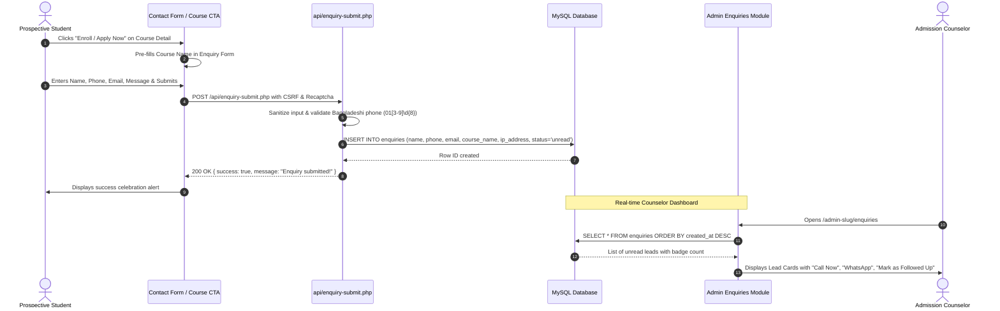

# 04. Course Detail & Frontend Pages: Exhaustive Dynamic Specification

## 1. Overview & Architectural Imperative
Every educational institution website must allow non-technical administrators to update course curriculums, pricing, syllabus modules, software tools, student projects, and SEO tags without touching PHP or database code.

Hardcoded content is forbidden. When an admin updates a field in the Admin Console, the change must immediately reflect across the User Panel, Schema.org Structured Data, and Search Engine crawlers.

---

## 2. Course Detail Page (`course-detail.php`) Dynamic Mapping

The table below defines every single component of `course-detail.php`, its database binding, administrative control interface, why it is needed, and its exact impact on the user panel and database:

| Component / Section | Database Storage Column & Type | Admin Control Interface | Why It Is Needed | User Panel & SEO Impact |
| :--- | :--- | :--- | :--- | :--- |
| **Course Identity** | `courses.title` (VARCHAR 255) `courses.slug` (VARCHAR 255 UNIQUE) `courses.department` (VARCHAR 100) | Form Wizard: Step 1 text inputs with auto-slug generation and Department dropdown | Establishes the primary course branding, clean URL routing, and categorization. | Updates `<h1>` header, breadcrumb path, canonical tag, and schema.org `Course.name`. |
| **SEO Meta Engine** | `courses.seo_title` (VARCHAR 255) `courses.meta_description` (TEXT) | Form Wizard: Step 4 live Google SERP preview box with character counters | Optimizes search ranking for high-intent keywords (e.g. "Graphic Design in Naogaon"). | Injects `<title>`, `<meta name="description">`, OpenGraph and Twitter card tags. |
| **Pricing & Tuition** | `courses.price` (DECIMAL 10,2) `courses.discount_price` (DECIMAL 10,2) | Form Wizard: Step 1 numerical currency inputs | Displays standard vs promotional course fees transparently. | Renders formatted BDT price with discount badge; feeds `schema.org/Offer.price`. |
| **Duration & Workload** | `courses.duration` (VARCHAR 100) `courses.total_classes` (INT) `courses.total_projects` (INT) | Form Wizard: Step 1 metric spinners (e.g. "4 Months", "32 Lectures", "12 Projects") | Informs students about commitment and depth of coursework. | Renders the 3 or 4-box responsive metric stat strip on the hero banner. |
| **Delivery Modes** | `courses.course_delivery_modes` (JSON Array) | Form Wizard: Step 3 interactive tag checkboxes (`Offline Labs`, `Online Zoom`, `Hybrid`) | Informs whether students can attend physically or remotely. | Generates badge pills with corresponding SVG icons next to the title. Fallback to site settings if null. |
| **Hero Media & Trailer** | `courses.thumbnail_url` (VARCHAR 500) `courses.video_url` (VARCHAR 500) | Form Wizard: Step 1 file uploader or YouTube / Vimeo URL input | High conversion visual hero with video trailer popup. | Clean thumbnail without blur; click triggers responsive YouTube/Vimeo video modal. |
| **Facilities Strip** | `courses.course_facilities` (JSON Array) | Form Wizard: Step 3 repeater input (e.g., `High-End Lab Access`, `24/7 Mentor Support`) | Highlights value additions that differentiate the institute. | Renders checkmark list strip below the hero. |
| **Curriculum Highlights**| `courses.curriculum_highlights` (JSON Array) | Form Wizard: Step 2 dynamic repeater for key syllabus bullet points | Bulleted breakdown of practical skills taught. | Renders the left-hand highlights checklist in the course breakdown section. |
| **Career Opportunities** | `courses.career_paths` (JSON Array) | Form Wizard: Step 2 dynamic repeater for career roles (e.g. `UI Designer`, `Creative Director`) | Proves return on investment and job prospects for prospective students. | Renders briefcase-tagged career badges grid. |
| **Class Structure** | `courses.course_class_structure` (JSON Array of Objects: `title`, `items`) | Form Wizard: Step 3 nested block builder (Theory vs Practical Lab breakdown) | Explains exactly how weekly hours and lab sessions are distributed. | Renders dual-card distribution containers with custom purple header badges. |
| **Prerequisites** | `courses.prerequisites` (JSON Array) | Form Wizard: Step 3 repeater tags (e.g., `Basic Computer Knowledge`, `Dedication`) | Filters candidates so they know system or mental requirements before enrolling. | Renders prerequisite badge strip with auto-detected laptop/desktop icons. |
| **Target Audience** | `courses.target_audience` (JSON Array of Objects: `title`, `desc`, `icon`) | Form Wizard: Step 3 persona card builder | Demonstrates suitability for beginners, university students, and job switchers. | Generates rich 4-column persona cards with SVG icons. |
| **Tools Mastered** | `courses.softwares_learned` (JSON Array of Objects: `name`, `category`, `icon`) | Form Wizard: Step 4 software master picker (`Photoshop`, `Figma`, `VS Code`, etc.) | Signals industry relevance and concrete technical competencies. | Generates interactive horizontal scroll carousel with genuine brand SVGs. |
| **Relational FAQs** | Relational: `faqs.course_id = courses.id` | FAQs Module: Course dropdown selector + order sort spinner | Resolves course-specific enrollment questions and concerns. | Renders dual-column accordion; falls back to general category FAQs if empty. |
| **Student Work Showcase**| Relational: `projects.course_id = courses.id` | Projects Module: Course assignment dropdown | Proves real capability with portfolios built by actual past graduates. | Pulls projects with badges, student names, and modal preview sliders. |
| **Enrollment CTA** | Dynamic URL parameter: `contact.php?course={course.title}` | Site Settings & Course Action bar | Direct conversion funnel for admissions. | Auto-populates selected course dropdown on contact inquiry form. |

---

## 3. Dynamic Specifications for Other Frontend Pages

### 3.1. Projects / Student Work Showcase (`projects.php` & `project-detail.php`)
- **Database Tables**: `projects` and `project_images`.
- **Admin Control**:
  - Add/Edit project card with student name, batch, course ID association, live URL, and GitHub repository.
  - Multi-image uploader for screenshots, mockups, and client briefs.
- **Frontend Impact**:
  - Filter by Department / Course pill buttons.
  - Click opens high-resolution image carousel modal and student credit footer.

### 3.2. Departments & Navigation (`includes/header.php`)
- **Database Table**: `departments` (`id`, `name`, `slug`, `icon`, `sort_order`, `is_active`).
- **Admin Control**:
  - Reorder department order via drag-and-drop or sort integer.
  - Toggle `is_active` to hide seasonal or deprecated departments.
- **Frontend Impact**:
  - Updates desktop mega-menu dropdown and mobile drawer accordion links automatically without hardcoding.

### 3.3. Institutional FAQs (`faq.php`)
- **Database Table**: `faqs` (`id`, `question`, `answer`, `category`, `course_id`, `sort_order`, `is_active`).
- **Admin Control**:
  - Categorize by `General`, `Admission`, `Career Support`, or link specifically to a Course.
  - Search filter in admin panel to manage dozens of questions efficiently.
- **Frontend Impact**:
  - Renders dual-column accessible accordions with SVG indicators.

### 3.4. Success Stories / Alumni Placement (`success-stories.php`)
- **Database Table**: `success_stories` (`id`, `student_name`, `course_id`, `company`, `role`, `salary_range`, `story_content`, `video_url`, `photo_url`, `is_featured`).
- **Admin Control**:
  - Featured alumni toggle (displays on homepage carousel).
  - Video interview link (YouTube embed).
- **Frontend Impact**:
  - Trust-building social proof cards with verified employment badges.

### 3.5. Contact & Campus Desks (`contact.php`)
- **Database Table**: `site_settings` (Keys: `contact_address`, `contact_hotlines`, `contact_emails`, `office_hours`, `campus_locations`).
- **Admin Control**:
  - Site Settings > Contact & Locations module.
- **Frontend Impact**:
  - Updates footer contact column, desktop quick-contact chips, and contact form header.

---

## 4. User Data Flow & Lead Management

