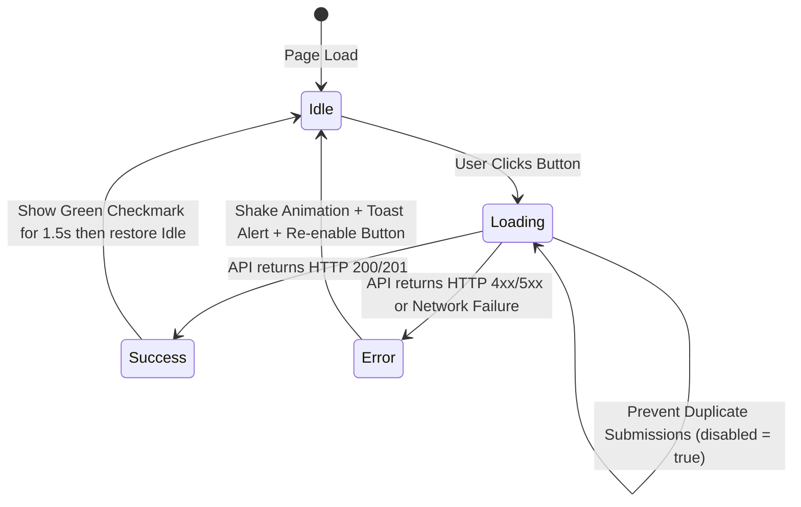

# 05. Admin API Contracts, Button Controls & Action Lifecycles

## 1. Architectural Principles
Every asynchronous administrative interaction (saving a multi-step form, toggling a course visibility switch, deleting an item, updating site settings) must adhere to a standardized **RESTful JSON API Contract**.

- **No Silent Failures**: Every response returns an explicit HTTP status code and a standardized JSON structure.
- **Micro-State Button Feedback**: Every interactive button reflects state transitions (`idle` -> `loading` -> `success` / `error` -> `revert`).
- **Idempotency & Reentrancy**: Double-clicking a save or submit button is prevented via client-side debouncing and temporary button disabling.

---

## 2. Universal API Response Schema

All admin endpoints return the following standard JSON envelope:

```json
{
  "success": true,
  "code": 200,
  "message": "Human-readable confirmation message",
  "data": {
    "id": 14,
    "slug": "professional-graphic-design",
    "updated_at": "2026-10-15 02:30:00"
  },
  "errors": []
}
```

In error scenarios:
```json
{
  "success": false,
  "code": 422,
  "message": "Validation failed on the provided input.",
  "data": null,
  "errors": {
    "title": "Course title is required.",
    "price": "Price must be a valid positive number."
  }
}
```

---

## 3. Core API Endpoints & Request Contracts

### 3.1. Course Management API

#### `POST /admin/api/courses/save.php`
- **Purpose**: Creates a new course or updates an existing course from the Multi-Step Form Wizard.
- **Auth**: Requires valid admin session & CSRF token header (`X-CSRF-Token`).
- **Request Payload**:
```json
{
  "id": 4,
  "title": "Mastering Full-Stack Web Development",
  "slug": "full-stack-web-development",
  "department": "web",
  "duration": "6 Months",
  "total_classes": 48,
  "total_projects": 15,
  "price": 28000,
  "discount_price": 22000,
  "overview": "Comprehensive full stack bootcamp covering modern PHP, Laravel, React, and MySQL.",
  "thumbnail_url": "https://example.com/assets/web.jpg",
  "video_url": "https://youtube.com/watch?v=xyz123",
  "course_delivery_modes": ["Offline (Campus Labs)", "Online Live Batch"],
  "course_facilities": ["High-End Lab Access", "24/7 Mentor Support", "Job Placement Support"],
  "curriculum_highlights": ["PHP 8.2 & Modern OOP", "REST API Development", "React SPA & State Management"],
  "career_paths": ["Full Stack Developer", "Backend Engineer", "Technical Lead"],
  "course_class_structure": [
    {
      "title": "Core Backend & Database Architecture",
      "items": [
        {"title": "Theory & ERD", "description": "Relational database normalization & schema design"},
        {"title": "Hands-on Lab", "description": "Writing optimized queries and transaction rollbacks"}
      ]
    }
  ],
  "prerequisites": ["Basic Programming Concept", "Personal Laptop"],
  "target_audience": [
    {"title": "Computer Science Students", "desc": "Bridge the gap between academic theory and industry engineering", "icon": "student"}
  ],
  "softwares_learned": [
    {"name": "VS Code", "category": "Editor", "icon": "vs code"},
    {"name": "PHP", "category": "Language", "icon": "php"},
    {"name": "React", "category": "Frontend", "icon": "react"}
  ],
  "seo_title": "Full-Stack Web Development Course in Bangladesh | DreamIT",
  "meta_description": "Join our 6-month hands-on full-stack web development course with real-world projects and placement.",
  "status": "active"
}
```

#### `POST /admin/api/courses/toggle-status.php`
- **Purpose**: Instant active/draft toggle from the Card View without opening the editor.
- **Request Payload**: `{"id": 4, "status": "active" | "draft"}`
- **Response**: `200 OK` `{ "success": true, "new_status": "active" }`

---

### 3.2. Student Projects API

#### `POST /admin/api/projects/save.php`
- **Request Payload**:
```json
{
  "id": null,
  "title": "E-Commerce Mobile App UI/UX Redesign",
  "course_id": 1,
  "student_name": "Rahim Ahmed",
  "student_batch": "Batch 24",
  "thumbnail_url": "https://example.com/project-thumb.jpg",
  "live_url": "https://behance.net/gallery/example",
  "tools_used": ["Figma", "Adobe Illustrator"],
  "description": "Full responsive design system and prototype for an apparel marketplace.",
  "is_featured": 1,
  "status": "active"
}
```

---

### 3.3. Institutional FAQ API

#### `POST /admin/api/faqs/save.php`
- **Request Payload**:
```json
{
  "id": null,
  "question": "Do I need to bring my own laptop to campus labs?",
  "answer": "No. Our campus labs are fully equipped with high-performance Core i7 workstations. However, having a personal laptop is recommended for home practice.",
  "category": "Admission",
  "course_id": null,
  "sort_order": 1,
  "is_active": 1
}
```

---

### 3.4. Site Settings & SEO API

#### `POST /admin/api/settings/save.php`
- **Request Payload**:
```json
{
  "settings": {
    "site_brand": "Creative IT Institute Naogaon",
    "contact_hotlines": "+880 1777308777, +880 1777308778",
    "contact_emails": "admission@dreamitnaogaon.com, info@dreamitnaogaon.com",
    "contact_address": "Momtaz Plaza (4th Floor), House # 07, Road # 04, Dhanmondi, Dhaka",
    "office_hours": "Saturday - Thursday: 9:00 AM - 8:00 PM",
    "facebook_url": "https://facebook.com/dreamitnaogaon",
    "youtube_url": "https://youtube.com/@dreamitnaogaon",
    "header_cta_text": "Free Seminar / Admission",
    "header_cta_url": "contact.php"
  }
}
```

---

## 4. Button State Management & Micro-Interactions



### 4.1. Implementation Code Pattern
```javascript
async function executeAdminAction(buttonEl, endpoint, payload) {
  // 1. Guard against double-clicks
  if (buttonEl.dataset.loading === 'true') return;

  // 2. Set loading state
  buttonEl.dataset.loading = 'true';
  buttonEl.disabled = true;
  const originalHtml = buttonEl.innerHTML;
  buttonEl.innerHTML = `<span class="spinner-border spinner-border-sm" role="status" aria-hidden="true"></span> Saving...`;

  try {
    const res = await fetch(endpoint, {
      method: 'POST',
      headers: {
        'Content-Type': 'application/json',
        'X-CSRF-Token': document.querySelector('meta[name="csrf-token"]').content
      },
      body: JSON.stringify(payload)
    });

    const data = await res.json();

    if (!res.ok || !data.success) {
      throw new Error(data.message || 'Operation failed');
    }

    // 3. Success state
    buttonEl.innerHTML = `<svg class="icon-check" viewBox="0 0 20 20" fill="currentColor"><path fill-rule="evenodd" d="M16.707 5.293a1 1 0 010 1.414l-8 8a1 1 0 01-1.414 0l-4-4a1 1 0 011.414-1.414L8 12.586l7.293-7.293a1 1 0 011.414 0z" clip-rule="evenodd"/></svg> Saved!`;
    buttonEl.classList.add('btn-success');
    showAdminToast('success', data.message);

    setTimeout(() => {
      buttonEl.innerHTML = originalHtml;
      buttonEl.classList.remove('btn-success');
      buttonEl.disabled = false;
      buttonEl.dataset.loading = 'false';
    }, 1500);

    return data;
  } catch (err) {
    // 4. Error state
    buttonEl.innerHTML = originalHtml;
    buttonEl.disabled = false;
    buttonEl.dataset.loading = 'false';
    buttonEl.classList.add('shake-error');
    showAdminToast('error', err.message);

    setTimeout(() => buttonEl.classList.remove('shake-error'), 600);
    throw err;
  }
}
```
